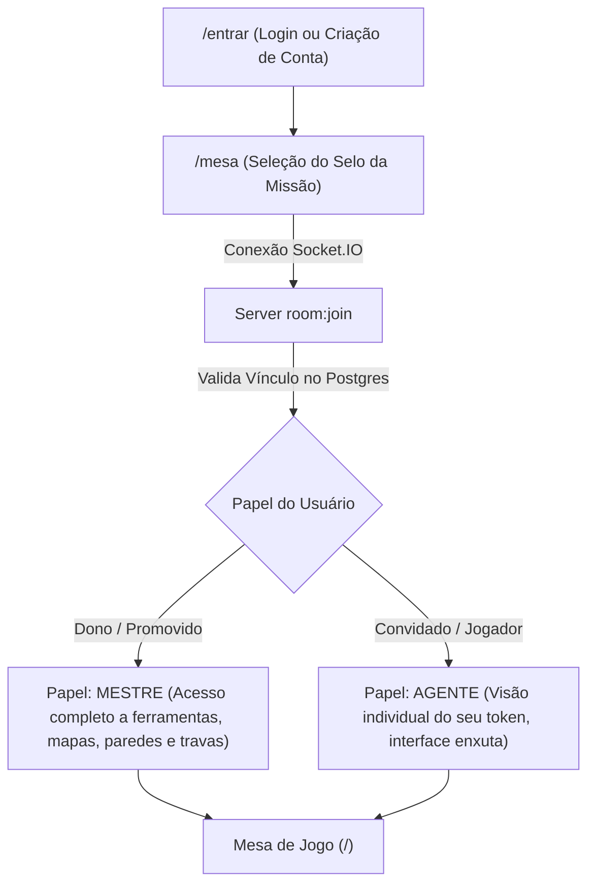

# AGENTS.MD — GUIA DO DESENVOLVEDOR & AGENTES IA (HELIO)

> **Este documento serve como mapa central de navegação e referência rápida para qualquer agente de IA ou desenvolvedor.**
> Consulte este arquivo para localizar arquivos, entender o fluxo de dados, tipos e regras antes de fazer buscas amplas no repositório.
> Para atualizar automaticamente a documentação do projeto, execute `node tools/docgen.mjs`.

---

## 1. Visão Geral da Arquitetura

O **HELIO** é uma mesa virtual de RPG tático (VTT) inspirada no universo paranormal (Ordo Realitas), com fog de war autoritativo, movimentação por turnos e gerenciamento de sessões com PostgreSQL e WebSockets (Socket.IO).

O monorepo está estruturado em 3 pacotes principais:
- [`shared/`](file:///c:/Users/Miiyh/Documents/GitHub/HELIO/shared): Tipos comuns, constantes, pathfinding, visão e grid.
- [`server/`](file:///c:/Users/Miiyh/Documents/GitHub/HELIO/server): Servidor autoritativo Node.js (Socket.IO + HTTP + PostgreSQL).
- [`client/`](file:///c:/Users/Miiyh/Documents/GitHub/HELIO/client): Frontend React 19 + Vite + TypeScript + HTML5 Canvas.
- [`deploy/`](file:///c:/Users/Miiyh/Documents/GitHub/HELIO/deploy): Docker Compose, Caddyfile e variáveis de ambiente.
- [`docs/`](file:///c:/Users/Miiyh/Documents/GitHub/HELIO/docs): Registro arquitetural e histórico de decisões (ADRs).

---

## 2. Mapa dos Arquivos de Código

### 2.1. Shared ([`shared/src/`](file:///c:/Users/Miiyh/Documents/GitHub/HELIO/shared/src))
Tipos e lógicas matemáticas compartilhadas entre cliente e servidor sem dependências externas.
- [`types.ts`](file:///c:/Users/Miiyh/Documents/GitHub/HELIO/shared/src/types.ts): Definições de `Actor`, `Cell`, `Role`, `Facing`, `FogValue`, `WallDisplayMode`, `Sector`, etc.
- [`constants.ts`](file:///c:/Users/Miiyh/Documents/GitHub/HELIO/shared/src/constants.ts): Constantes de grid (`DEFAULT_COLS`, `DEFAULT_ROWS`, `DEFAULT_CELL`), valores de Fog (`FOG_NONE`, `FOG_SEEN`, `FOG_VIS`, `FOG_REVEAL`), paletas e ferramentas (`TOOLS`).
- [`grid.ts`](file:///c:/Users/Miiyh/Documents/GitHub/HELIO/shared/src/grid.ts): Criação e redimensionamento de matrizes de grade (`makeWalls`, `makeFog`, `resizeGrid`, `inBounds`).
- [`vision.ts`](file:///c:/Users/Miiyh/Documents/GitHub/HELIO/shared/src/vision.ts): Algoritmo de Linha de Visão (Bresenham `hasLOS`) e cálculo de campo visual (`computeVision`, `visibleCellsFrom`).
- [`pathfinding.ts`](file:///c:/Users/Miiyh/Documents/GitHub/HELIO/shared/src/pathfinding.ts): BFS para movimentação ortogonal e desvio de obstáculos (`findPath`, `facingBetween`).
- [`id.ts`](file:///c:/Users/Miiyh/Documents/GitHub/HELIO/shared/src/id.ts): Gerador de identificadores únicos com prefixo (`uid`).
- [`index.ts`](file:///c:/Users/Miiyh/Documents/GitHub/HELIO/shared/src/index.ts): Barril de exportação de todas as funções utilitárias.

---

### 2.2. Servidor ([`server/src/`](file:///c:/Users/Miiyh/Documents/GitHub/HELIO/server/src))
Servidor autoritativo de eventos em tempo real e persistência com fallback suave para memória caso o Postgres esteja offline.
- [`index.ts`](file:///c:/Users/Miiyh/Documents/GitHub/HELIO/server/src/index.ts): Inicialização do HTTP/Socket.IO, listeners de sockets (`room:join`, `actor:intent-move`, `fog:discover`, `map:walls`, `map:config`, `actor:*`, `sector:*`), rate limit e boot.
- [`room.ts`](file:///c:/Users/Miiyh/Documents/GitHub/HELIO/server/src/room.ts): Estruturas em memória da sala (`Room`), cena autoritativa (`ServerScene`), jogadores conectados (`Player`) e serialização pública (`publicState`).
- [`store.ts`](file:///c:/Users/Miiyh/Documents/GitHub/HELIO/server/src/store.ts): Operações de banco para campanhas e cenas, debounce de escrita (`scheduleSave`, `saveRoom`), carregamento (`loadScene`) e criação (`createCampaign`).
- [`validate.ts`](file:///c:/Users/Miiyh/Documents/GitHub/HELIO/server/src/validate.ts): Regras autoritativas de movimentação (`canMove`) verificando dono do token, paredes, permissão global e alcance de 1 passo.
- [`accounts.ts`](file:///c:/Users/Miiyh/Documents/GitHub/HELIO/server/src/accounts.ts): Gestão de contas de usuário e vinculações de membros a campanhas (`membership`).
- [`auth.ts`](file:///c:/Users/Miiyh/Documents/GitHub/HELIO/server/src/auth.ts): Criptografia de senhas com `scrypt`, emissão e validação de cookies de sessão assinados com `HMAC-SHA256`.
- [`http.ts`](file:///c:/Users/Miiyh/Documents/GitHub/HELIO/server/src/http.ts): Rotas REST de autenticação (`/auth/*`), configuração pública (`/api/settings`), campanhas (`/campaigns`), papéis (`/campaigns/:selo/role`) e painel do administrador (`/admin/*`: contas, senha, delegação e configuração viva).
- [`settings.ts`](file:///c:/Users/Miiyh/Documents/GitHub/HELIO/server/src/settings.ts): Configuração viva do servidor (ADR #25) — cadastro aberto/fechado e sala da casa, persistidos em `app_setting` e aplicados sem restart; o `.env` é o padrão de fábrica.
- [`db.ts`](file:///c:/Users/Miiyh/Documents/GitHub/HELIO/server/src/db.ts): Pool do Postgres (`pg`) com wrapper seguro `tryQuery` para não derrubar o servidor em caso de indisponibilidade do banco.
- [`migrate.ts`](file:///c:/Users/Miiyh/Documents/GitHub/HELIO/server/src/migrate.ts): Executor de migrações SQL versionadas presentes em `server/migrations/`.
- [`selo.ts`](file:///c:/Users/Miiyh/Documents/GitHub/HELIO/server/src/selo.ts): Gerador e normalizador de Selos de Missão mnemônicos (ex: `CORVO-AMBAR-VEU-74`).
- [`live.ts`](file:///c:/Users/Miiyh/Documents/GitHub/HELIO/server/src/live.ts): Ponte de eventos internos (ex: mudança de papel de mestre para socket em tempo real).

---

### 2.3. Frontend Client ([`client/src/`](file:///c:/Users/Miiyh/Documents/GitHub/HELIO/client/src))
Aplicação SPA com React 19, Zustand e renderizador Canvas 2D.
- **Telas Principais**:
  - [`App.tsx`](file:///c:/Users/Miiyh/Documents/GitHub/HELIO/client/src/App.tsx): Roteamento (`/entrar`, `/mesa`, `/`, `/local`, `/admin`).
  - [`screens/Entrar.tsx`](file:///c:/Users/Miiyh/Documents/GitHub/HELIO/client/src/screens/Entrar.tsx): Tela 1 — Autenticação (Login e Criação de Conta na Ordem).
  - [`screens/Mesa.tsx`](file:///c:/Users/Miiyh/Documents/GitHub/HELIO/client/src/screens/Mesa.tsx): Tela 2 — Seleção de Missão/Selo (último usado, missão mais recente ou a sala da casa definida no painel), identificação do papel (`mestre` ou `agente`) e conexão.
  - [`screens/Admin.tsx`](file:///c:/Users/Miiyh/Documents/GitHub/HELIO/client/src/screens/Admin.tsx): Painel de administração — redefinição de senhas, delegação de admin e configuração do servidor (cadastro e sala da casa).
  - [`screens/Shell.tsx`](file:///c:/Users/Miiyh/Documents/GitHub/HELIO/client/src/screens/Shell.tsx): Wrapper visual estilizado com estética paranormal esotérica para as telas de entrada.
- **Componentes do Tabuleiro**:
  - [`components/FogWarMap.tsx`](file:///c:/Users/Miiyh/Documents/GitHub/HELIO/client/src/components/FogWarMap.tsx): O componente central da mesa virtual.
    - Loop de renderização Canvas a 60fps (background, paredes finas/invisíveis/blocos, atores, setores e fog of war).
    - Perspectiva individual de visão por token para jogadores.
    - Controle de zoom (scroll e pinch-to-zoom) e pan (espaço + drag).
    - Topbar e Mobile Dock contextuais conforme o papel (Mestre vs Jogador).
    - Grimório lateral deslizante (Drawer).
  - [`components/PlayersPanel.tsx`](file:///c:/Users/Miiyh/Documents/GitHub/HELIO/client/src/components/PlayersPanel.tsx): Painel de participantes da sessão, controle de travas de movimento e promoção de mestres.
  - [`components/icons.tsx`](file:///c:/Users/Miiyh/Documents/GitHub/HELIO/client/src/components/icons.tsx): Biblioteca vetorial SVG (sigilos, olhos, espadas, ferramentas, mandalas, etc).
  - [`components/Notice.tsx`](file:///c:/Users/Miiyh/Documents/GitHub/HELIO/client/src/components/Notice.tsx): Toast / avisos temporários do servidor.
- **Renderização Gráfica**:
  - [`render/sprites.ts`](file:///c:/Users/Miiyh/Documents/GitHub/HELIO/client/src/render/sprites.ts): Renderização de tokens redondos, spritesheets animados ou humanoides procedurais, placas de identificação e badges de trava `🔒`.
  - [`render/animation.ts`](file:///c:/Users/Miiyh/Documents/GitHub/HELIO/client/src/render/animation.ts): Interpolação e transição suave do deslocamento dos tokens entre casas.
  - [`render/assets.ts`](file:///c:/Users/Miiyh/Documents/GitHub/HELIO/client/src/render/assets.ts): Carregador dos manifestos de tokens e mapas gerados.
  - [`render/images.ts`](file:///c:/Users/Miiyh/Documents/GitHub/HELIO/client/src/render/images.ts): Cache em memória de instâncias de `Image()` HTML.
- **Gerenciamento de Estado (Zustand)**:
  - [`state/gameStore.ts`](file:///c:/Users/Miiyh/Documents/GitHub/HELIO/client/src/state/gameStore.ts): Estado da cena (grade, atores, paredes, setores, predição local de movimento e reconciliação).
  - [`state/netStore.ts`](file:///c:/Users/Miiyh/Documents/GitHub/HELIO/client/src/state/netStore.ts): Estado de rede (status da conexão, socket id, papel do usuário, lista de jogadores).
  - [`state/sessionStore.ts`](file:///c:/Users/Miiyh/Documents/GitHub/HELIO/client/src/state/sessionStore.ts): Dados da conta logada via cookie de sessão.
- **Comunicação de Rede**:
  - [`net/socket.ts`](file:///c:/Users/Miiyh/Documents/GitHub/HELIO/client/src/net/socket.ts): Gerenciamento da conexão Socket.IO e sincronização de eventos.
  - [`net/auth.ts`](file:///c:/Users/Miiyh/Documents/GitHub/HELIO/client/src/net/auth.ts): Chamadas à API HTTP de autenticação e campanhas.
  - [`net/bridge.ts`](file:///c:/Users/Miiyh/Documents/GitHub/HELIO/client/src/net/bridge.ts): Ponte para envio desacoplado de intenções do gameStore para o socket.

---

## 3. Fluxo de Vida de uma Partida



---

## 4. Comandos de Manutenção & Build

- **Typecheck do Servidor**:
  ```powershell
  npm --prefix server run typecheck
  ```
- **Compilação do Cliente**:
  ```powershell
  npm --prefix client run build
  ```
- **Reconstrução dos Containers Docker**:
  ```powershell
  docker compose -f deploy/docker-compose.yml up -d --build
  ```
- **Atualização Automática do Mapa do Código**:
  ```powershell
  node tools/docgen.mjs
  ```
